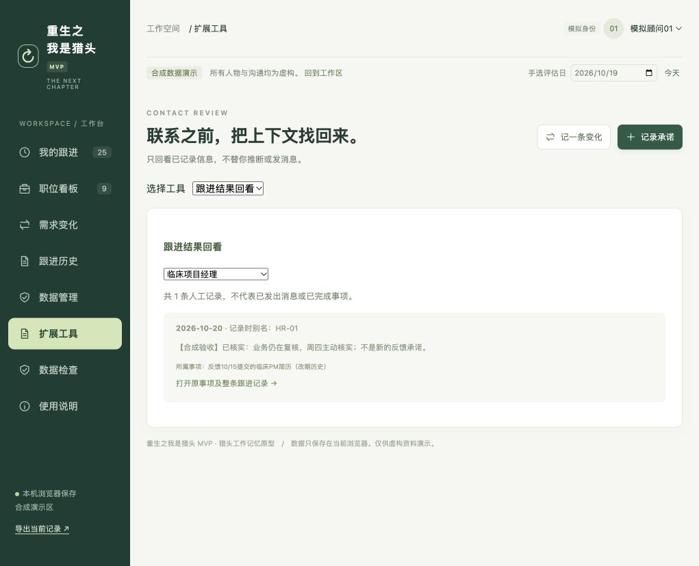

# 重生之我是猎头 MVP

一个面向猎头顾问的工作记忆原型：记录需求变化、追踪承诺、保存跟进结果，在下一次联系前找回上下文。

当前版本：**0.7.0**。使用原生 HTML/CSS/JavaScript 与 Python 标准库，无需安装前端依赖。



## 为什么做这个作品

从一次校园招聘活动的复盘出发，我把“问清需求、管理预期、及时反馈”转化为可操作的记录流程，并借助 AI 完成需求收缩、代码迭代和验收设计。

产品重点是帮顾问记住“发生了什么变化、谁答应了什么、下次跟进得到了什么结果”。本版没有接入 LLM，也不会自动判断隐性需求、评分或淘汰候选人。

## 可以做什么

- 按职位记录需求变化和来源，人工更新同步进度。
- 跟踪承诺期限；条件未满足时保持等待，不自动判断逾期。
- 将自己的内部回看日与对方承诺截止日分开。
- 记录、修正跟进结果，改期后仍可回看历史结果。
- 按职位和别名回看，检索已记录的信息。
- 导出完整 JSON 备份，校验并预览恢复；支持上一次保存恢复点。

## 本机运行

需要 Python 3。下载源码后，在项目目录执行：

```sh
python3 start.py
```

固定入口为 `http://127.0.0.1:8876/`。保持启动窗口打开，按 Ctrl+C 停止。Mac 也可双击 `启动工作台.command`。

工作版首次进入空白工作区。点击“查看演示”可体验虚构案例；工作区与演示区分开保存。

## 网页演示

`docs/index.html` 是默认进入合成案例的独立演示网页，全部资源内嵌。网页部署后，数据仍保存在每位访问者自己的浏览器；不会形成共享数据库。

本仓库附带 GitHub Pages 发布流程。仓库所有者需要在 **Settings → Pages → Source** 选择 **GitHub Actions**，再运行 **Deploy demo to GitHub Pages**。以该工作流实际输出的网页地址为准；上传源码不等于网页已发布。

## 构建和验证

需要近期版本 Node.js（支持 `node:test`）和 Python 3。

```sh
python3 build.py
node --test tests/*.test.cjs
python3 -m unittest discover -s tests -p 'test_*.py' -v
python3 build_pages.py
```

v0.7 原版验收：93 项 JavaScript 检查和 3 项启动器检查通过；已用合成资料操作验证结果保存、改期回看、旧版备份导入和恢复。详见[验收记录](验收记录.txt)。这不代表所有环境和输入永不出错。GitHub Actions 是否通过以实际运行结果为准。

## 项目结构

| 路径 | 用途 |
| --- | --- |
| `dist/core.js` | 状态、日期与业务操作 |
| `dist/data.js` | 校验、迁移与备份 |
| `dist/storage.js` | 本机保存与恢复点 |
| `dist/modules/` | 可扩展的回看视图 |
| `dist/app.js` | 页面交互 |
| `tests/` | 自动检查 |
| `docs/` | Pages 演示页面 |

扩展规则见[扩展开发约定](扩展开发约定.md)，变更见[更新日志](更新日志-v0.7.txt)。

## 使用边界

这是单人、本机、非敏感别名记录原型，不是企业 ATS。没有企业鉴权、跨设备同步、CTS/Voice 接口、后台通知或真实顾问试点结论。身份切换不等于登录；本机数据与备份未加密。请勿录入真实简历、联系方式或敏感资料。

日期按上海时区处理。换浏览器、地址或端口不会自动迁移旧数据；迁移前先下载完整备份。

仓库中的人物、职位、沟通与截图均为合成演示资料；不包含个人浏览器中的工作记录。
